# FastAiApi Codex++ 改动与验收报告

日期：2026-10-24；系统：macOS arm64。报告不包含密码、API Key、验证码和收件链接令牌。

## 参考程序对比

已读取文档及截图，对桌面提供的两个 DMG 做只读挂载、签名与内容检查，并在用户手动打开参考程序后完成真实注册。

- Codex++ 参考版本 1.7.6，实际品牌为「即刻API」，服务指向 https://geekapis.com/v1；与文档截图中的 FastAiApi 品牌不同。使用授权测试邮箱注册，用户名 cpp_verify_1024，余额 ¥0.00。未给参考平台充值。
- 登录前为全屏入口：左侧品牌/三步流程，右侧登录和注册；注册后自动配置，进入概览。
- 概览包含连接状态、账户余额、模型地址、刷新余额、充值、退出。模型面板支持搜索、单选、重新获取、当前默认标记及应用；测试账号看到 8 个模型。
- 参考页面说明密码不保存、登录状态保存在系统凭据库；二进制存在 platform_login / restore / fetch_models / select_model / retry_configuration 及会话存取符号。
- 参考注册使用用户名、可选邮箱和邀请码；你的平台使用邮箱与验证码。参考余额接口是 quota，本地是美元 balance；不能直接复制旧接口或人民币标签。
- 参考注册会写入默认 Codex 配置。已事先备份，并在核对后恢复原 FastAiApi 配置，未点击参考程序的“重启 Codex”。
- ChatGPT.dmg 是 26.1007.30912，具有 OpenAI 开发者签名和公证票据，深度签名校验通过。当前安装为更新的 26.1016.51333。ASAR 文本未检出 FastAiApi/CodexPlusPlus 定制标记，没有证据表明需要覆盖当前客户端。
- 参考包未附 Rust 源码；以上为真实界面、符号和包内容对比，不能声称掌握其完整源码差异。

两个包的 SHA256 及详细元数据见 reference-analysis.json。

## 本地改动点

| 模块 | 实现 |
| --- | --- |
| 登录入口 | 根组件包一层 FastAiApiGate，未登录不显示管理器；全屏品牌和登录/注册切换 |
| 注册登录 | FastAiApi 邮箱、密码、验证码及邀请码开关；登录成功后自动配置 |
| 自动配置 | 复用专用 Key；缺失时在 gpt-pro 分组创建；默认 gpt-5.6-sol，已有模型选择保留；失败可重试 |
| 会话 | macOS 系统钥匙串保存访问令牌；密码默认不保存，勾选记住后单独保存在系统钥匙串；其他平台/钥匙串不可用时保持内存会话；令牌过期后重新登录 |
| 概览 | FastAiApi Logo、连接状态、实际美元余额、刷新、平台网站、充值、退出 |
| 模型 | 搜索/单选面板、当前默认标记、重新获取；过滤媒体和内部审核模型；保留上下文及压缩设置 |
| 充值 | 内置支付宝与微信套餐、下单、付款码、查单及续付；不在客户端自行增加余额 |
| 技能 | integrations/fastaiapi/media-api 独立目录，14 文件随二进制内嵌，部署到 skills/fastaiapi-media；不覆盖用户已有内容 |
| 品牌打包 | 使用用户 SVG 与应用图标，固定本地 bundle，macOS arm64 分发 ZIP |

上游改动边界：本轮 main.tsx 只增加一个 import 和根组件包装，不新增 App.tsx 路由改动。界面、样式、模型面板、自动配置与测试放在独立 fastaiapi 模块；系统凭据实现位于 fastaiapi_session.rs。Cargo.toml 仅增加锁文件已有的 security-framework 3.7.0 直接依赖，调用 macOS 系统接口。

## 已完成的线上测试

| 测试 | 结果 |
| --- | --- |
| icloud-hme 启动与收码 | 本地 5050 服务正常，收到 FastAiApi 验证码 |
| 真实注册 | 成功，测试用户 ID 230，初始 $0.50 |
| 重新登录 | 同一账号退出后重新登录成功 |
| 添加测试额度 | 按授权后台加 $5，备注明确为测试额度，非支付订单 |
| 余额一致性 | 后台和桌面均显示 $5.50 |
| 专用 Key | 已授权创建 gpt-pro Key，ID 411 |
| 模型配置 | 配置指向 https://fastaiapi.cloud/v1，gpt-5.6-sol |
| Codex 启动 | 独立实例 fastaiapi-411 启动成功，启动记录 PID 92885 |
| 非流式模型调用 | Responses HTTP 200，completed，返回 FASTAIAPI_TEST_OK |
| 流式模型调用 | HTTP 200，11 个事件，response.completed，返回 STREAM_OK |
| 支付宝 | ¥1 订单 RA5597460512b9a03bb2afffc8c7ab88，付款码显示成功 |
| 微信 | ¥1 订单 RA38118dd75d76eac9ff03a040991680，付款码显示成功 |
| 未付款状态 | 未出现虚假到账，余额未因创建订单增加 |
| 历史订单 | 可读取两笔订单；续付曾返回 409，查单曾返回 429，显示错误并提示勿重复付款 |

上表线上流程在 a0782aaa 版本完成。最新登录门控和钥匙串恢复另见下方，不以旧版本测试代替新代码验收。

## 自动化与构建

- 前端 TypeScript 检查通过。
- onboarding 三项测试通过：新用户自动建 Key、重登复用 Key/保留模型、无分组/空模型拒绝错误配置。
- 核心 fastaiapi Release 单元测试三项通过。
- 先前管理器两项测试通过：完整技能安装/保留用户文件、模型切换保留上下文。
- 内置媒体 Python 回归 40 项通过，技能本轮未更改。
- 本轮首次 debug 构建遇到磁盘不足；未批量删除文件，空间回升后改用 Release 验证。
- 最新管理器 Release 两项测试通过，正式构建、签名、固定 bundle 启动成功。
- 模型切换测试已扩展：原配置模板含旧 model 时，更新后的有效模型仍必须为新选择，同时保留 reasoning/context 配置。

## 最新实机回归

全屏登录入口、注册表单验证码字段、测试账号登录自动配置、模型搜索过滤、退出门控、重启恢复会话，以及退出后重启仍显示登录页已实测通过。

模型切换实测发现旧 config_contents.model 优先级覆盖新的 profile.model，已在账户模块中同时更新两处并通过增强回归；修复后配置文件真实写入 gpt-6.1-sol，重启仍保持该默认模型和登录状态，已通过。测试结束已恢复 gpt-5.6-sol。

本轮登录余额为 $5.42，随后模型请求消耗后刷新至 $5.40。后台加款与余额消耗均以实际平台值为准。

## 未通过完整验收的边界

1. 未执行实际扫码付款，因此支付成功回调、实际到账及退款链路未验收。后台加测试额度不能代替支付到账测试。
2. Codex 聊天窗口操作被计算机工具对 com.openai.codex 的访问限制阻止；没有绕过。独立进程启动和直接模型 API 调用不等于聊天框完整端到端测试。
3. 图片/Grok/H3 真实生成尚未执行，需要各自分组密钥及额度。技能安装与 40 项回归不等于真实付费生成通过。
4. Python 3.10+ 运行时仍需系统已有，应用未捆绑解释器；用户不需要另装技能文件。H3 使用 newapi.fastaiapi.cloud，不复用对话 Key。
5. macOS 以外的系统凭据持久化尚未实现；访问令牌过期时需要重新登录，未实现自动 refresh-token。

## 截图证据

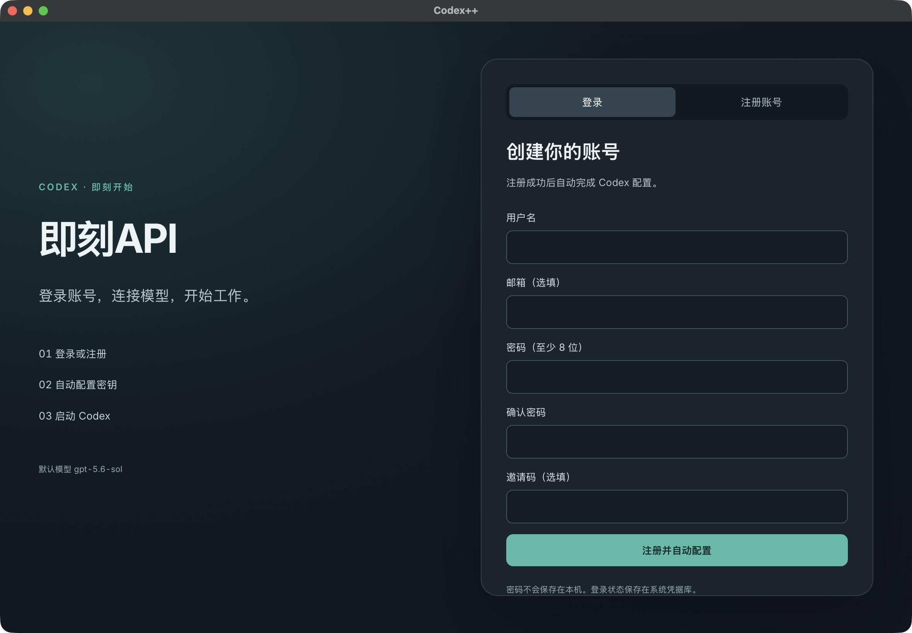
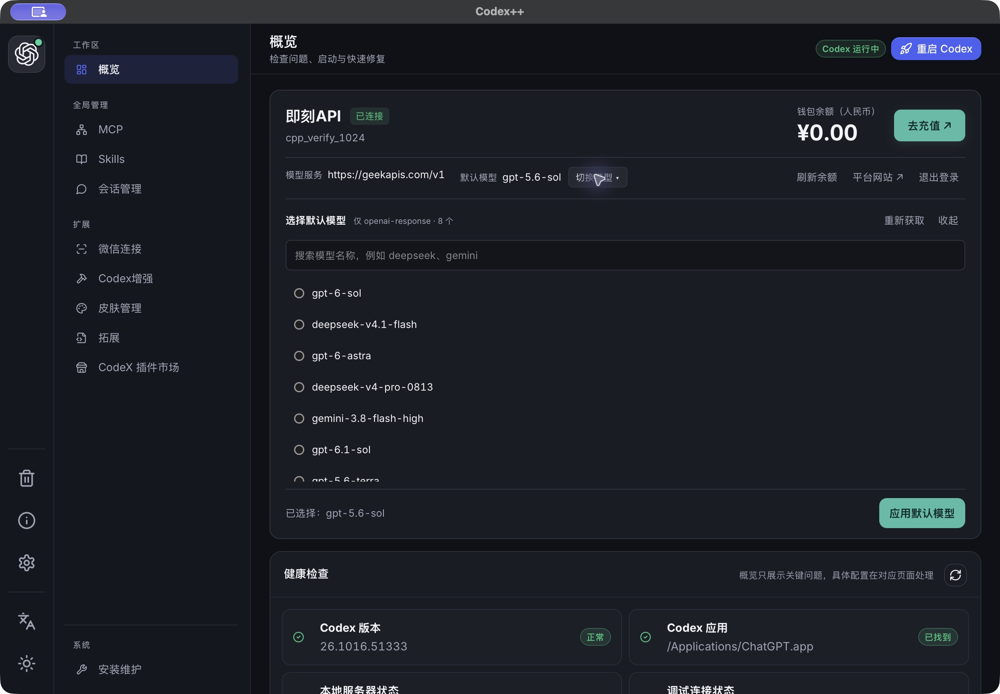
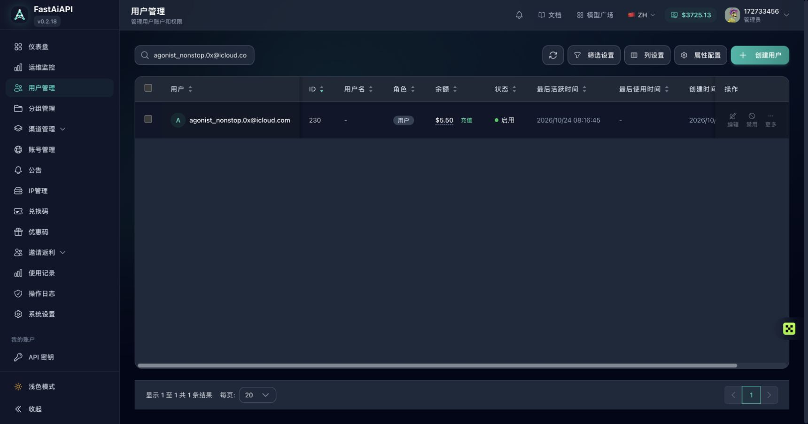
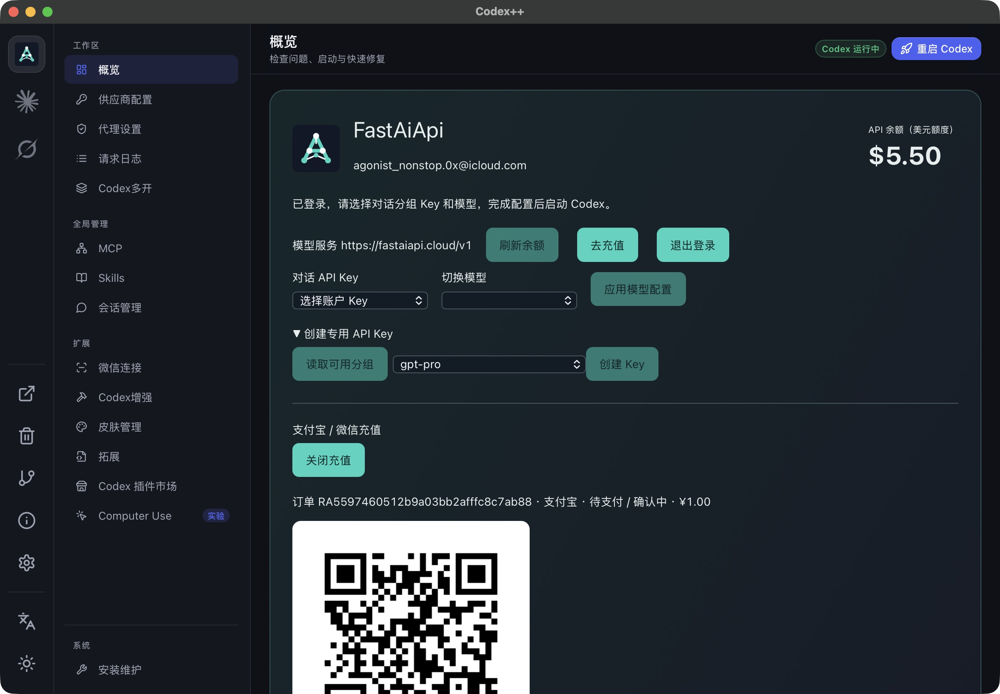
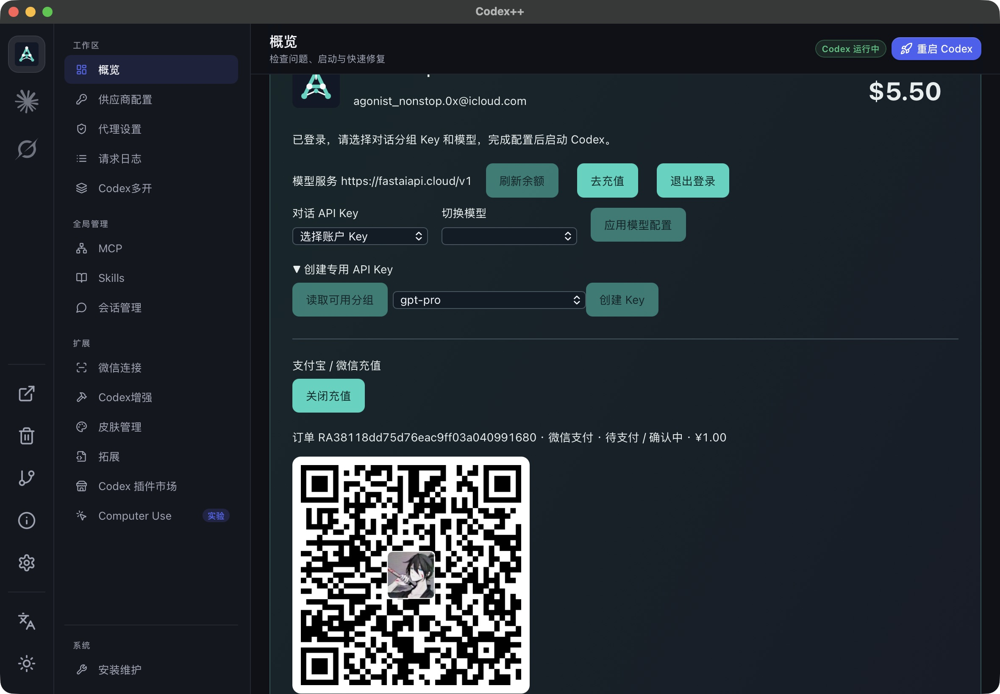
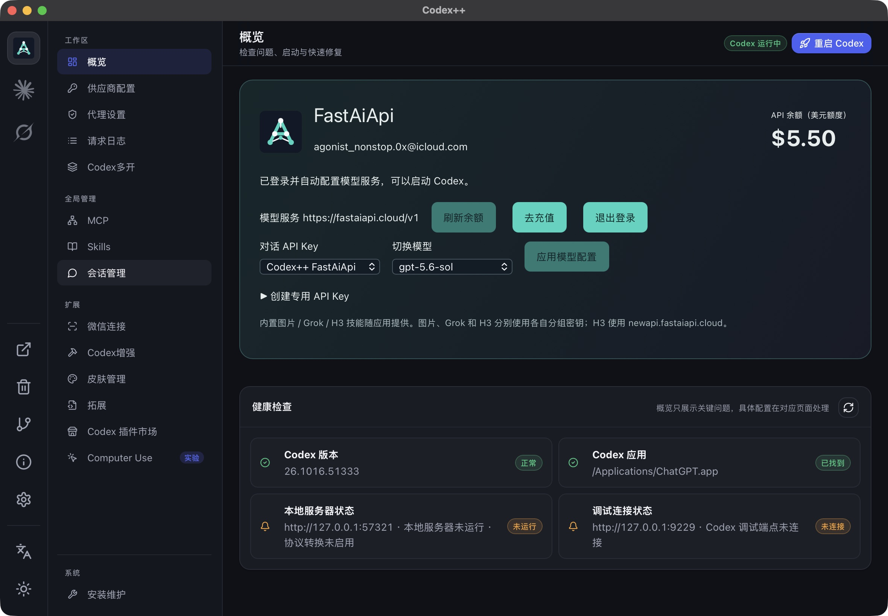
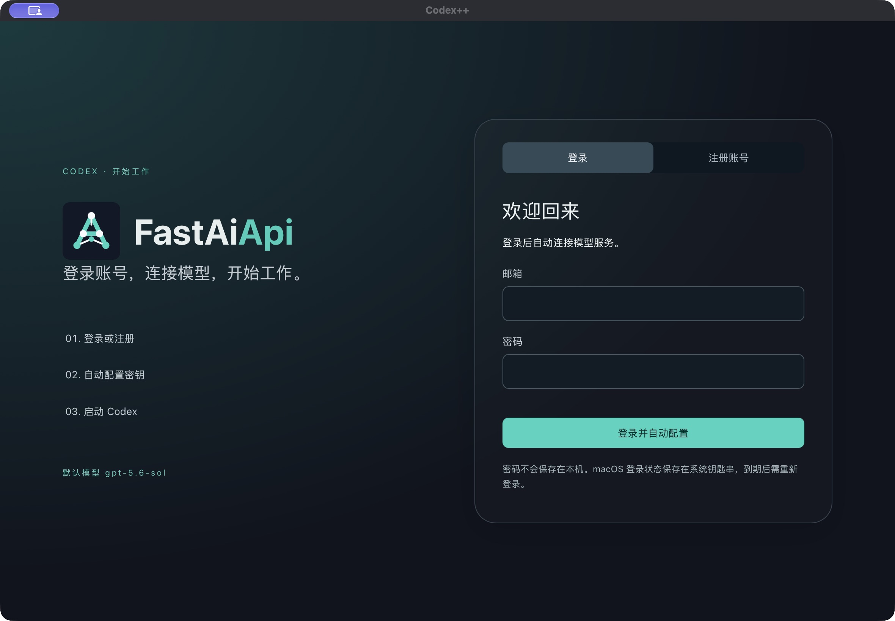

报告与含账号信息的截图仅保留本地，不纳入代码提交。

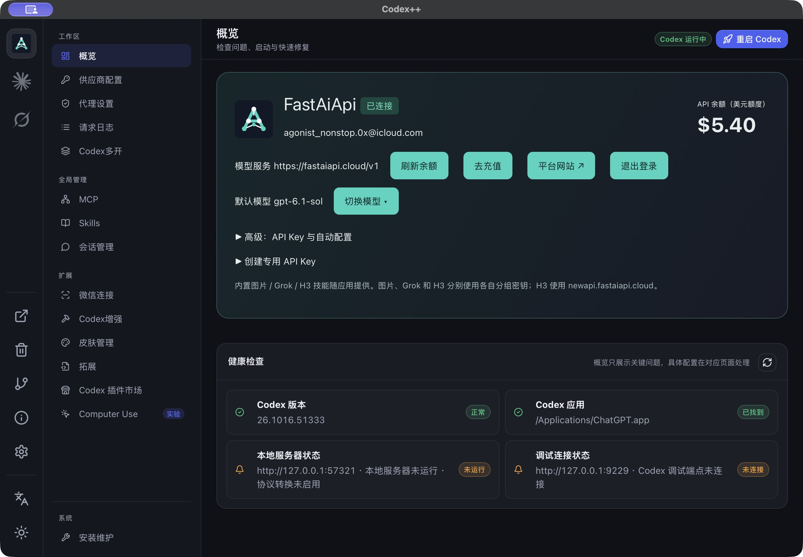
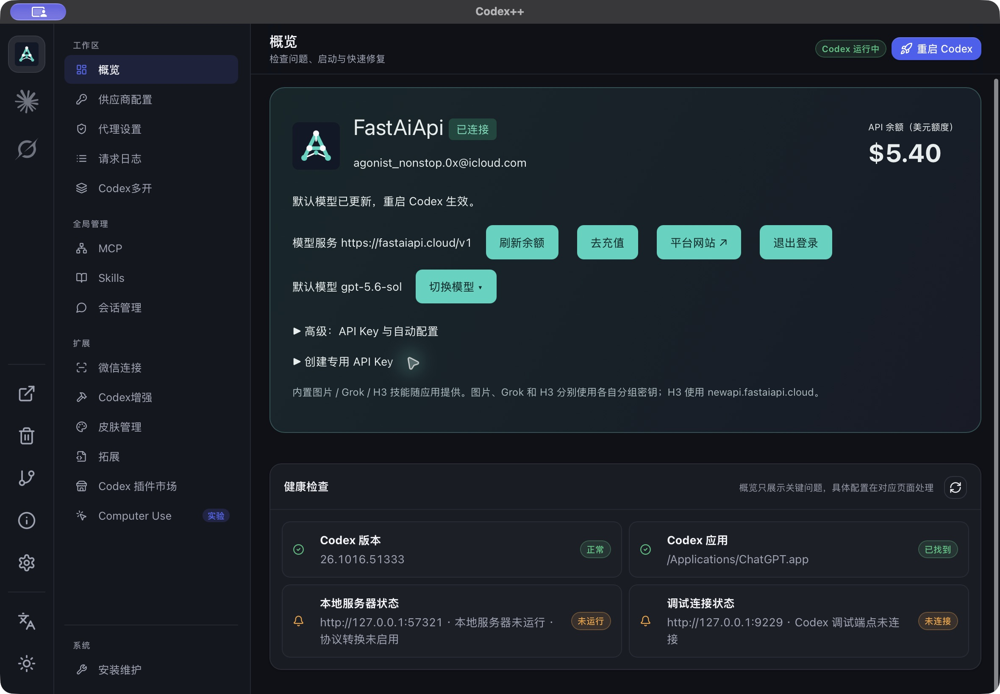

最终应用已运行：dist/local-build/Codex++.app。分发包 dist/FastAiApi-CodexPlusPlus-macos-arm64.zip 已更新并通过 ZIP 完整性校验；分发应用签名校验通过，不带开发环境 LSEnvironment。

本轮提交 b6c4bc98，已快进合入本地 main；未推送远端。保留当前 fastai 分支检出与用户 .idea 文件。

## 侧栏对齐与记住账号密码（追加）

- 仅保留 Codex 工具；隐藏 Claude、Grok、推荐内容、Agent 协作以及参考界面没有的供应商配置、代理设置、请求日志、多开、Computer Use 入口。保留底层实现，导航策略独立在 fastaiapi/navigation.ts。
- 登录/注册页增加默认不勾选的“记住账号密码”。只有认证成功后保存到 macOS 独立钥匙串项目；退出登录保留，取消勾选立即清除。没有明文文件或 localStorage 保存，也不会向平台发送记住偏好。
- 新增 fastaiapi_credentials.rs，账户和会话令牌仍分别管理。
- TypeScript 检查、4 项前端账户/导航测试、17 项相关导航回归和 4 项原生接口测试通过；Release 已构建启动。

- 记住密码实机回归通过：勾选并登录→退出自动填充→重启仍填充；取消勾选→重启后邮箱/密码均为空、复选框未勾选。测试保存记录已清除。

## 账户卡片与支付弹窗设计

账户卡片重排为品牌/账户、余额/充值、服务/模型与次要操作区域，保留独立样式。充值迁移至 Recharge.tsx 原生 dialog，包含金额卡片、支付宝/微信 SVG 图标、扫码页、订单记录及支付状态；支持 Escape/关闭按钮/遮罩关闭和原生焦点约束。图标离线打包，来源记录在 icons/README.md。

7 项前端账户/导航/支付状态测试通过，TypeScript 与 Release 构建通过。支付状态新增退款优先判定，过期/退款停止轮询并不展示二维码；切换订单忽略旧二维码响应。实际视觉和两渠道付款码显示已验收，见下方补测记录。

最新构建后的实机验收被 macOS 钥匙串授权提示阻塞：应用等待系统允许读取登录会话。计算机工具禁止操作 com.apple.SecurityAgent，已请用户手动完成；尚未将新版卡片视觉与两渠道 dialog 验收记为通过。此前版本两渠道下单/二维码显示已验证，但不替代本轮新界面验收。

本轮代码提交 5f7b7f87，已快进合入本地 main，未推送。最新分发 ZIP 已更新、签名及 ZIP 完整性通过。

## 钥匙串授权后实机补测

用户完成系统授权后，会话恢复成功，账户卡片显示 $5.40 USD 与 gpt-5.6-sol。已核对卡片排版、余额/充值主操作、服务/模型信息和高级配置折叠区域。

- 充值 Dialog 正常居中，背景遮罩模糊，支付宝/微信渠道 Logo 显示正常；人民币支付金额与美元 API 额度分别展示。
- 支付宝 ¥1 订单 RAa7fd46c449efa0350c4d7f8a3e64c8：真实付款码成功显示。
- 微信 ¥1 订单 RA9212db8ebacacaa62b1677b2c75e67：真实付款码生成并成功显示。
- Escape 与右上角关闭按钮均可关闭弹窗，重新进入正常。
- 最近订单由 2 笔增至 4 笔，两笔新订单显示“待确认”，旧订单显示“已过期”，没有误报到账；账户余额仍为 $5.40。
- 未实际扫码付款，支付回调/实际到账仍未验收。此次仅补充 UI 和真实下单/二维码展示测试，无代码变更，无需重新构建。
- 应用已返回账户概览并保持运行。

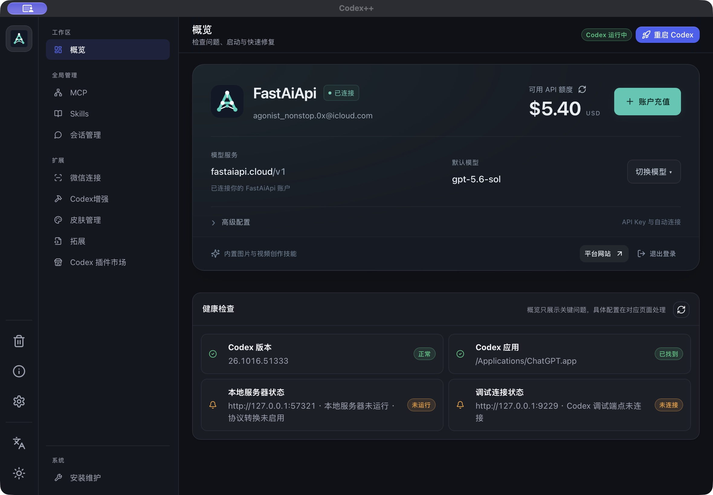
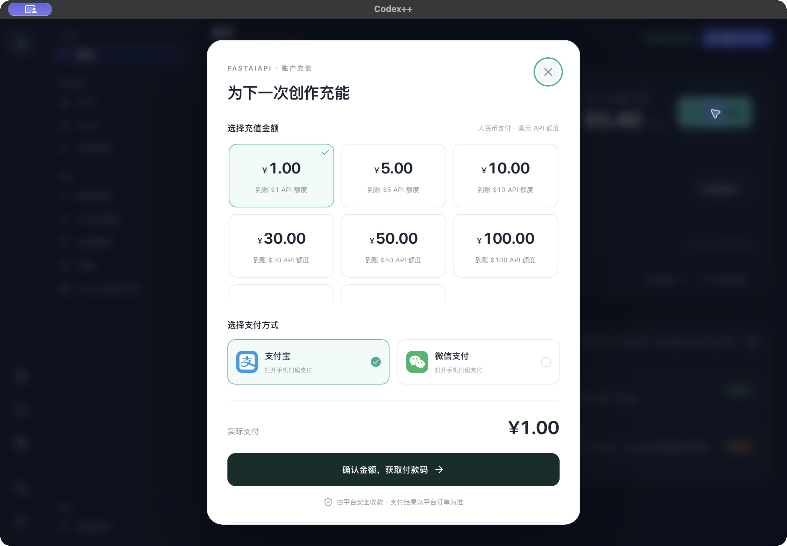
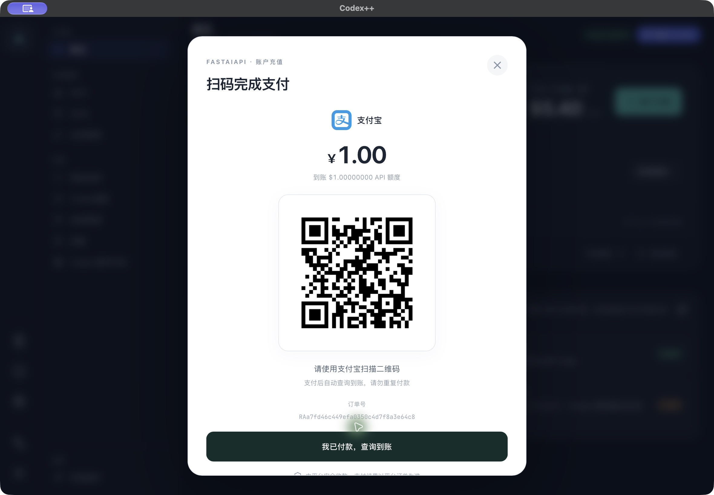
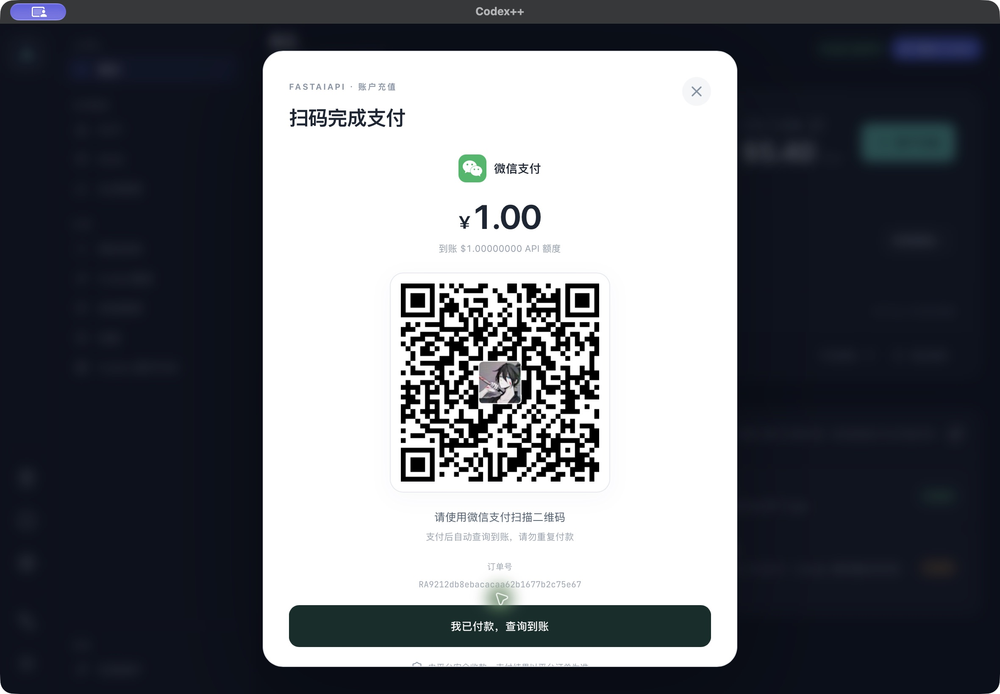

## 高级配置展开裁切修复

账户概览改用普通文档流，卡片随内容增长，移除内容裁切；窄窗口下配置控件可换行。仅修改独立 overview.css。7 项相关前端测试与 TypeScript 检查通过，Release 构建启动完成。实机验证高级配置及创建专用 Key 两层同时展开，控件和卡片页脚全部可见，页面可滚动至健康检查底部。分发 ZIP 已同步更新并校验通过。提交 c79f1558 已合入本地 main。

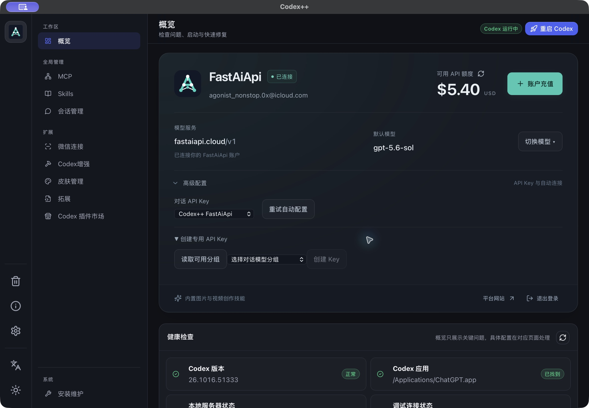

## 分组与模型选择 Dialog（c7ef3203）

按用户最新范围，仅修改我们新增的 FastAiApi 页面。新增独立 KeyDialog、ModelDialog、responsive.css 和会话分组缓存，保留原管理页面布局。

- 创建 Key 改为可搜索 Dialog，分组每行两个，打开默认选中第一组。实机显示 12 组、gpt-pro 默认选中，全部选项和底部按钮可见。
- 分组在登录或恢复登录后预加载，本次会话复用同一请求结果；退出清空，失败允许重试。缓存并发复用与失败重试测试通过。
- 切换模型改为 Dialog，支持搜索、当前默认标识、刷新和确认。实机显示 10 个模型；搜索 gpt-5.6-sol 后确认成功，弹窗关闭并显示更新提示，默认模型仍为 gpt-5.6-sol。
- 新增弹窗限制视口高度、列表内部滚动，底部操作按钮保留；账户及登录页增加窄宽度布局和长文本换行。
- TypeScript 检查与 9 项相关前端测试通过；Release 构建启动完成，分发应用重新签名，ZIP 完整性校验通过。
- 实机截图尺寸 2360×1640，验证当前用户窗口下布局；未声称所有屏幕尺寸均完成实机测试。本轮未新增真实 Key、付款或模型消费。
- 提交 c7ef3203 已合入本地 main，应用保持运行。

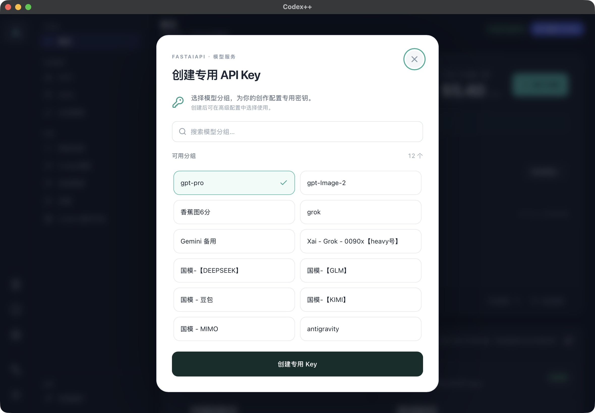
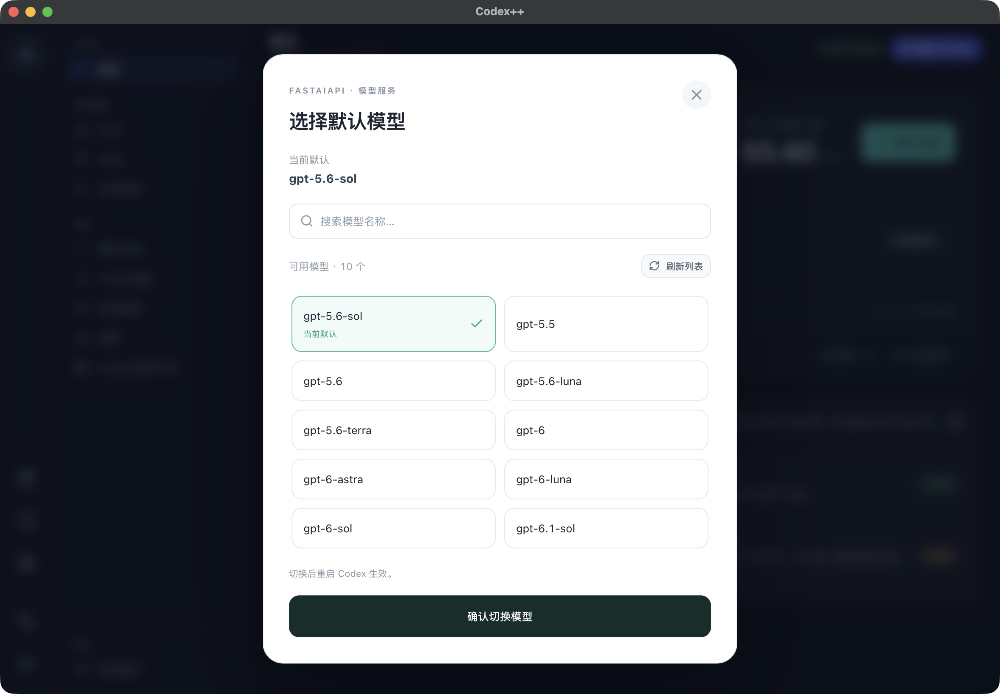

## Key 平铺与分组描述（f336e270）

- 对话 API Key 改为横向平铺的单选卡片，选中高亮，空间不足自动换行。
- 重试自动配置放在操作区最右侧，补充复用/创建专用 Key 并重新写入连接配置的说明。
- 创建 Key 的分组展示真实 description，最多 12 个字符，超长省略；问号使用原生 title 提供完整悬停提示。没有描述的分组不显示空占位。
- TypeScript 和 9 项前端回归测试通过；Release 已重新构建启动。实机验证默认 Key 高亮、按钮位置、12 组的描述截断以及问号完整 Help 内容。工具无悬停接口，原生提示浮层未单独截图。
- 提交 f336e270 已合入本地 main。本轮没有创建 Key 或修改默认模型。

## 反馈、手册、分组详情与生产部署（最终验收）

本节替代此前“进行中”记录；以下是当前交付状态。代码已提交并推送 main，服务器通过 Git 拉取，最新提交 dc02a8e7。历史章节中的“未推送”和临时阻塞仅描述当时状态。

### 本轮改动

- 分组问号固定在最右侧；点击打开独立详情 Dialog，不改变选中分组。修复 Esc 冒泡导致双层弹窗同时关闭的问题。
- 概览下面新增反馈、手册。反馈支持 7 类问题、标题、正文、联系方式及最多 3 张 PNG/JPEG/WebP 截图（每张不超过 1 MB）；失败保留输入，成功展示编号。
- 手册提供 10 项可搜索 FAQ、QQ 群 48878665、微信群二维码。已加入桌面的 qq_fastaiapi.jpg 和 wx_fastaiapi.jpg，点击可放大，图片自适应小窗口；微信群二维码标注到期日期 2026-10-31。
- 后端最终采用本仓库 services/feedback 独立 Go 轻量中转，文件持久化，无 PostgreSQL 依赖。包含官方账户鉴权、截图真实格式校验、幂等、每用户限流、通知队列与失败重试。
- 独立管理员登录页不出现在客户端导航；可搜索/筛选反馈、查看正文与截图、配置及测试 Lark。Webhook 和签名密钥仅存后台，不进入客户端或 Git。

### 部署结果

- 管理入口：https://fastaiapi.cloud/fastaiapi/feedback-admin
- 用户反馈接口：POST https://fastaiapi.cloud/fastaiapi/api/feedback
- 服务器源码：/opt/fastaiapi-groups/CodexPlusPlus；容器 fastaiapi-feedback，监听 127.0.0.1:6099，自动重启策略 unless-stopped。
- 持久化目录：/opt/fastaiapi-feedback-data；管理员账号 admin，初始密码保存在该目录的 admin-password（0600），报告不记录密码。
- Nginx 仅新增反馈与管理入口转发，原充值配置未改。配置检查与 reload 通过，原配置备份为 /etc/nginx/conf.d/fastaiapi.conf.feedback-backup-1792836381。
- 生产健康检查通过；无账户凭据的反馈请求返回 401。管理页面必须登录才能读取反馈。

### 真实生产端到端结果

使用已登录的本地 Codex++ 经生产接口提交一条带截图反馈：

- 编号：a5316c02-384c-4a97-bc40-f51f7e01002f
- 标题：正式链路验收：截图反馈与 Lark 通知
- 客户端显示成功回执；后台保存正文、联系方式和 1 张截图，管理员详情可查看图片。
- 「FastAiApi 用户反馈」Lark 群收到相同编号的真实通知，后台显示“已送达（尝试 1 次）”。截图存储于后台，Lark 文本提示截图数量。
- 测试中第一次上传文件扩展名为 PNG、实际字节为 JPEG，被正确拒绝为 400，未创建记录且输入保留。改用匹配 JPEG 扩展名后提交成功。

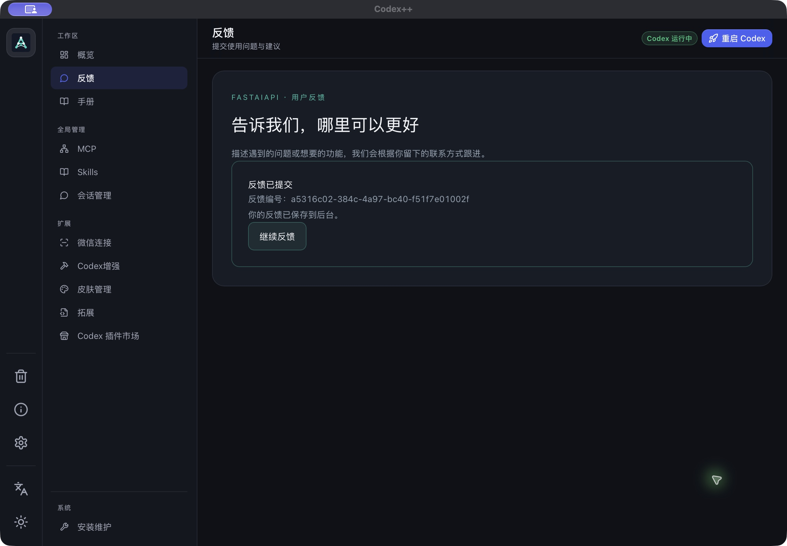
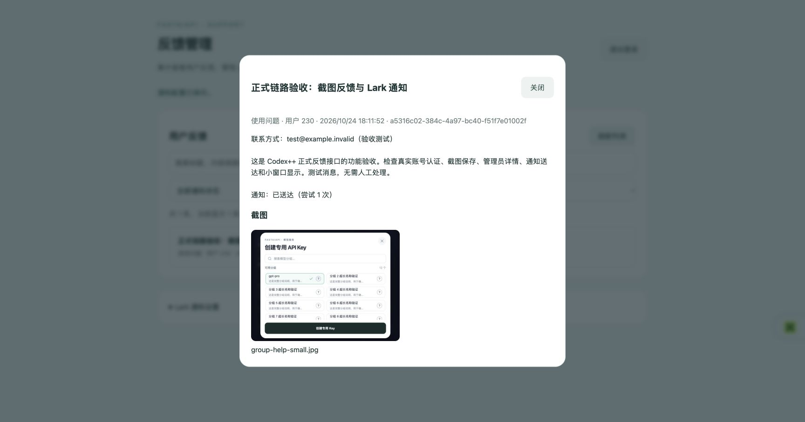
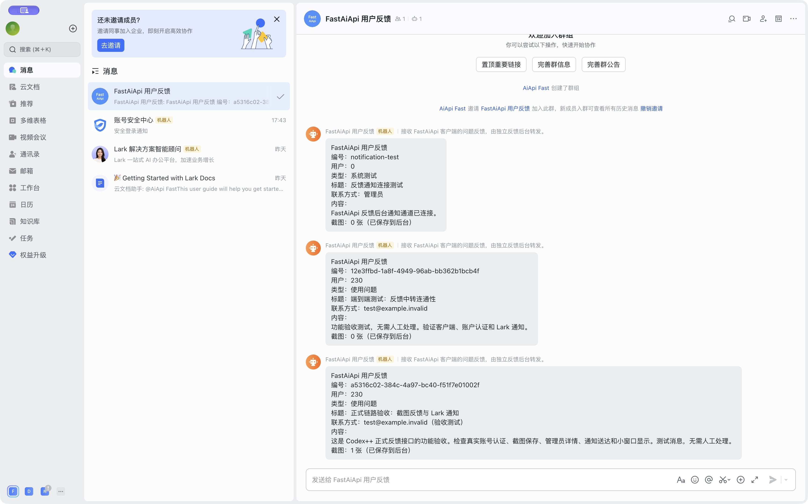

### 响应式与交互检查（仅我们的新增页面）

- 真实 React 组件配合隔离模拟接口检查 480×600：登录/注册、概览展开、横向 Key、反馈与手册均无横向溢出；截图添加/移除、失败保留字段、FAQ 搜索/展开通过。这部分不替代真实接口验收。
- 480×600：分组保持两列、默认首项，底部按钮完整可见；点击第 2 组问号不改变第 1 组选中，Esc 只关闭详情。问号 title 已核对，原生悬浮提示气泡未单独完成视觉截图验收。
- 640×480：模型确认按钮可见；充值弹窗高度 456 px，内容内部滚动。
- QQ/微信二维码 480×600：Dialog 位于 y=12 到 588，图片完整显示且无横向溢出，关闭与 Esc 可用；复制 QQ 群号反馈正常。
- 生产管理详情 480×600：Dialog 位于 y=12 到 588，内部内容可滚动，图片加载正常，页面宽度 480 无横向溢出；Esc 关闭后恢复列表。
- 原生客户端真实提交表单可滚动到截图与提交按钮，成功回执正常显示。没有声称原生应用所有尺寸均已逐项测试。

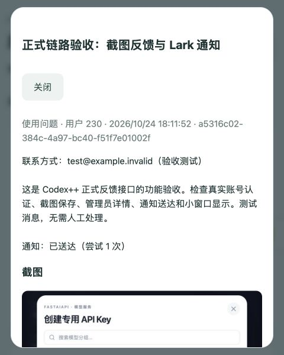
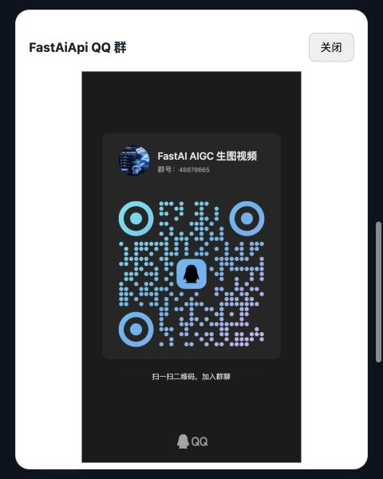

### 自动检查与交付物

- 前端完整测试：761 项，760 通过、0 失败、1 跳过；TypeScript 检查通过。
- Rust FastAiApi 相关 4 项测试通过；独立 Go 服务全部包测试通过（含鉴权、登录/退出、CSRF、限流、持久化、幂等和通知）。
- 最新代码 Release 已构建，并启动固定 dist/local-build/Codex++.app；已移除本地反馈路由覆盖，当前应用调用生产接口。
- 分发包 dist/FastAiApi-CodexPlusPlus-macos-arm64.zip 已更新、重新签名，并通过 ZIP 完整性校验；无开发状态目录或开发 LSEnvironment。
- 本轮未实际扫码付款，支付回调与真实到账仍未验收；此前支付宝/微信真实下单和付款码展示结果见前文。
- 报告与含测试账户信息的截图只保留本地，不提交 Git；用户 .idea/ 保持不变。
